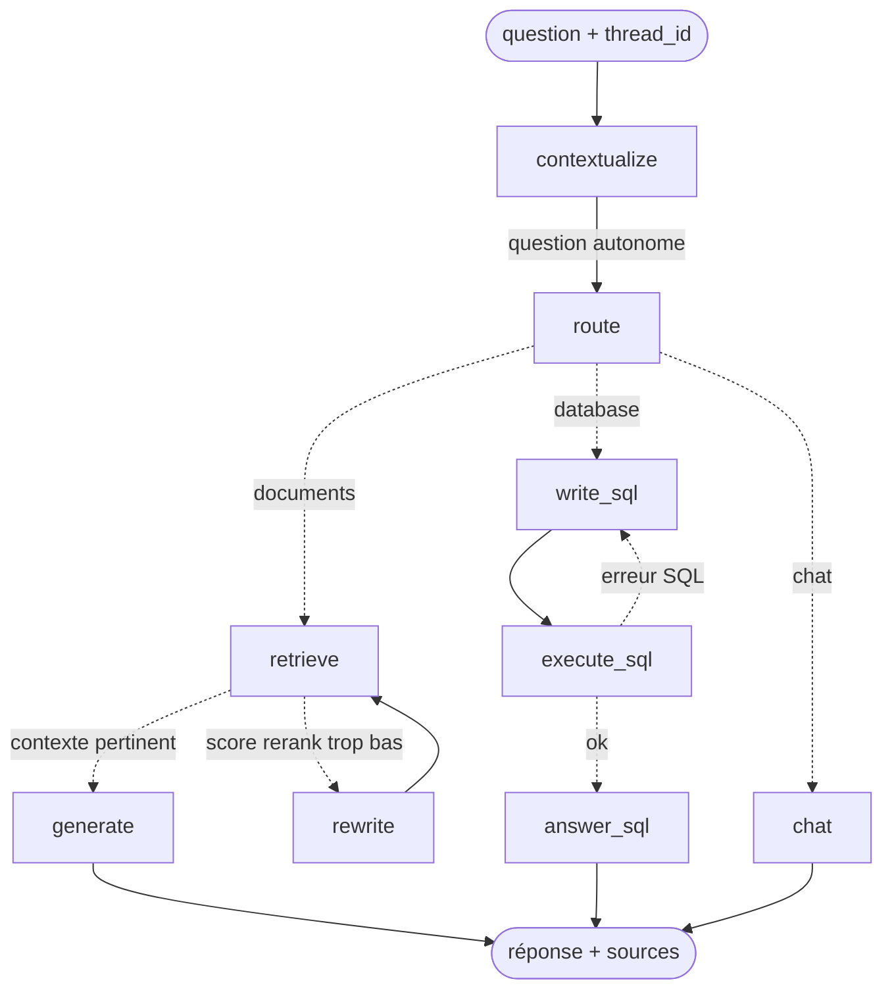

# RAG agentique V2 — LangChain · LangGraph · PostgreSQL/pgvector · LangSmith

Assistant qui répond en langage naturel à partir de **documents** (PDF, Word) et de **données tabulaires** (Excel, CSV).
Un graphe **LangGraph** choisit la bonne stratégie : **RAG correctif**, **Text-to-SQL auto-corrigé** ou conversation simple, avec **mémoire de conversation** persistée.

La V2 réécrit la V1 (développée sans framework) avec l'écosystème standard. Les briques maison qui apportaient une vraie valeur sont conservées, en particulier les parseurs PDF/Word qui extraient les tableaux en Markdown.

> 📘 **Documentation complète** (fonctionnement détaillé, outils, exploitation, préparation d'entretien) : [doc/README.md](doc/README.md)

---

## Architecture



| Brique | Rôle | Implémentation |
|---|---|---|
| **Ingestion** | PDF/Word → pages structurées → chunks → vecteurs | `BaseLoader` maison (parseurs V1) + `RecursiveCharacterTextSplitter` + API `index()` avec `SQLRecordManager` (incrémental, sans doublons) |
| **Données tabulaires** | Excel/CSV → tables SQL | `pandas.to_sql` dans le schéma `tabular` de PostgreSQL |
| **Recherche** | hybride + rerank | `PGVector` + `BM25Retriever` fusionnés par `EnsembleRetriever` (RRF), puis cross-encoder `bge-reranker-base` |
| **RAG correctif** | évite les hallucinations | si le meilleur score de rerank est sous le seuil : reformulation puis nouvelle recherche ; sinon refus **sans appel LLM** |
| **Text-to-SQL** | questions analytiques | `SQLDatabase` (schéma et lignes d'exemple) → génération → exécution → auto-correction sur erreur |
| **Mémoire** | questions de relance (« Et sa température ? ») | checkpointer `PostgresSaver` (clé `thread_id`) + nœud de contextualisation |
| **Observabilité** | traces de chaque nœud et de chaque appel LLM | LangSmith (variables d'environnement, aucun code à écrire) |
| **API** | intégration | FastAPI : `/api/ask`, `/api/ask/stream` (SSE), `/api/upload`, `/api/documents`, `/api/health` |
| **Interface** | démo utilisateur | React + Vite : chat en streaming, étapes du graphe en direct, sources, SQL, gestion des documents |

**Un seul PostgreSQL** contient les vecteurs (pgvector), les tables métier et l'historique des conversations. On a donc une seule base à sauvegarder, sécuriser et déployer.

### Sécurité du Text-to-SQL (défense en profondeur)
1. Filtre statique : une seule instruction `SELECT`/`WITH`, mots-clés dangereux refusés.
2. Transaction `READ ONLY` + `statement_timeout`.
3. Rôle PostgreSQL `rag_reader` qui n'a que `SELECT` sur le schéma `tabular` (créé par `docker/init.sql`). Même si les deux premières barrières cèdent, Postgres refuse l'écriture (vérifié : `ERROR: must be owner of table`).

---

## V1 → V2 : ce qui a changé

| V1 (code maison) | V2 |
|---|---|
| ChromaDB + SQLite + Chroma pour Vanna | **PostgreSQL unique** (pgvector + tables + mémoire) |
| Orchestrateur `rag_chain.py` (~1 000 lignes) | **Graphe LangGraph** explicite, testable nœud par nœud |
| Client HTTP Ollama / Azure écrit à la main | `init_chat_model` : OpenAI ou Ollama via `.env` |
| Vanna + `schema_rag.py` (~1 300 lignes) | `SQLDatabase` LangChain + boucle d'auto-correction |
| Ré-ingestion = doublons à gérer | API `index()` + `RecordManager` : idempotent |
| Pas de mémoire de conversation | `PostgresSaver` par `thread_id` |
| Logs maison | Traces LangSmith + évaluation (`eval/run_eval.py`) |
| — | CI GitHub Actions (lint + tests + build Docker) |

**Conservé de la V1 :** les parseurs `app/parsers/` (tableaux PDF/Word convertis en Markdown, suppression des en-têtes répétés, pages logiques Word) et les règles métier du prompt RAG.
**Compromis assumé :** le profilage de colonnes de `schema_rag.py` (valeurs réelles, formats) était plus riche que le `get_table_info()` de LangChain. À réintroduire si le Text-to-SQL bute sur des colonnes hétérogènes.

---

## Interface web (le plus simple)

Prérequis : **Docker Desktop** lancé et **Ollama** démarré avec `qwen2.5:1.5b`.
Double-cliquer sur **`demarrer.bat`**. Le script démarre PostgreSQL, compile l'interface au premier lancement, lance le serveur puis ouvre **http://localhost:8001**.

L'interface permet de :
- poser des questions, avec la réponse qui s'affiche au fil de la génération ;
- suivre en direct les **étapes du graphe LangGraph** (analyse, choix de la source, recherche, reformulation…) ;
- voir la **source choisie** (Documents / Base de données / Discussion), les **passages cités** avec leur score de pertinence et la **requête SQL** exécutée ;
- garder plusieurs **conversations**, chacune avec sa mémoire (questions de relance comme « Et sa température ? ») ;
- **ajouter** des fichiers par glisser-déposer (ils sont indexés automatiquement) ou en **supprimer** (ils sont retirés de l'index).

Pour développer l'interface avec rechargement à chaud : lancer l'API (`uvicorn app.api:app --port 8001`), puis `cd frontend && npm run dev` → http://localhost:5173.

---

## Démarrage rapide (ligne de commande)

```bash
# 1. Base de données
docker compose up -d db

# 2. Environnement Python (torch CPU d'abord pour éviter ~2 Go de CUDA)
python -m venv .venv && .venv\Scripts\activate
pip install torch --index-url https://download.pytorch.org/whl/cpu
pip install -r requirements.txt
copy .env.example .env

# 3. LLM local (ou LLM_PROVIDER=openai + OPENAI_API_KEY dans .env)
ollama pull qwen2.5:1.5b

# 4. Corpus de démo (secteur transport) puis ingestion
python -m scripts.make_samples && copy samples\* data\documents\
python -m scripts.ingest

# 5. Utilisation
python -m scripts.ask --trace                 # chat en console avec mémoire
uvicorn app.api:app --port 8001               # interface → http://localhost:8001 · API → /docs
```

Exemples d'appels à l'API :
```bash
curl -X POST localhost:8001/api/ask -H "Content-Type: application/json" \
     -d '{"question": "Quel est l indice de protection du PV-300 ?", "thread_id": "demo"}'
curl -N -X POST localhost:8001/api/ask/stream -H "Content-Type: application/json" \
     -d '{"question": "Et sa temperature de fonctionnement ?", "thread_id": "demo"}'
```

Tout en conteneurs : `docker compose --profile full up --build`.

### Observabilité LangSmith
Dans `.env` : `LANGSMITH_TRACING=true`, `LANGSMITH_API_KEY=...`, `LANGSMITH_PROJECT=rag-v2`. Chaque requête apparaît alors comme une trace avec le détail de chaque nœud du graphe : prompts, latences, tokens, documents récupérés.

---

## Tests, CI, évaluation

```bash
pytest -q                  # 27 tests, sans LLM ni base (faux LLM / retriever / SQL injectés)
ruff check app tests scripts eval --exclude app/parsers
python -m eval.run_eval --file eval/questions_demo.txt   # évaluation de bout en bout
```

- **Tests du graphe** (`tests/test_graph.py`) : le graphe reçoit ses dépendances par injection, ce qui permet de tester chaque chemin de façon déterministe : RAG, reformulation puis refus, SQL avec auto-correction, mémoire multi-tours, panne d'un appel LLM auxiliaire.
- **CI** (`.github/workflows/ci.yml`) : lint, tests, puis build de l'image Docker (interface React incluse, build multi-étapes).
- **Évaluation** (`eval/run_eval.py`) : métriques `answered`, `cited`, latence, et `groundedness` en option (LLM-juge, `--judge`). Avec `LANGSMITH_API_KEY`, les questions deviennent un dataset LangSmith et chaque exécution une expérience comparable dans l'interface. Sans clé, les résultats sont écrits en CSV dans `eval/results/`.

### Résultats mesurés (PC local, CPU uniquement, corpus de démo)

| LLM | Bonnes réponses (9 questions, mémoire incluse) | Latence moyenne |
|---|---|---|
| `qwen2.5:0.5b` | 4/8 : routage, reformulation et SQL défaillants | ~5 s |
| `qwen2.5:1.5b` (**défaut**) | **8/9**. Échec : un `GROUP BY` mal écrit en SQL | ~12 s (1er appel ~35 s : chargement des modèles) |

Retrieval : le bon passage arrive en tête du rerank avec un score de 0.93 à 0.97 sur toutes les questions documentaires.

**Limites connues** (mesurées, pas supposées) :
- `cited = 0` avec `qwen2.5:1.5b` : le modèle n'écrit pas les citations `[fichier, page]` dans sa réponse. L'API renvoie néanmoins les `sources` de façon structurée.
- Sur un modèle local aussi petit, le routage LLM est encadré par des garde-fous déterministes : SQL seulement si la question est analytique **et** cite le vocabulaire des tables ; `chat` seulement pour un message court. Avec `LLM_PROVIDER=openai`, ces garde-fous servent rarement.

---

## Structure

```
app/
  config.py         réglages (pydantic-settings, .env)
  llm.py            fabriques LLM / embeddings (OpenAI | Ollama | HuggingFace)
  loaders.py        Loader LangChain autour des parseurs V1
  parsers/          parseurs PDF/Word repris de la V1
  ingestion.py      chunking + index() incrémental + Excel/CSV → Postgres
  vectorstore.py    PGVector, RecordManager, engine
  retriever.py      recherche hybride + rerank
  sql_backend.py    SQLDatabase + exécution en lecture seule
  prompts.py        ChatPromptTemplate (règles métier V1)
  graph/            état + construction du graphe LangGraph
  api.py            FastAPI (JSON + SSE), sert aussi l'interface buildée
frontend/           interface React (Vite) : chat, étapes, sources, documents
scripts/            ingest, ask (CLI), make_samples
eval/               run_eval.py + jeux de questions
tests/              tests unitaires et tests du graphe
docker/init.sql     extension vector, schéma tabular, rôle lecture seule
demarrer.bat        lancement en un double-clic
```

## Pistes suivantes
- Version async (`ainvoke`, `AsyncPostgresSaver`) pour la montée en charge de l'API.
- Human-in-the-loop LangGraph (`interrupt`) pour valider une requête SQL sensible avant son exécution.
- Jeu d'évaluation avec réponses de référence et métriques RAGAS (`context_recall`, `faithfulness`).
- Déploiement Azure Container Apps + Azure Database for PostgreSQL (pgvector disponible).
